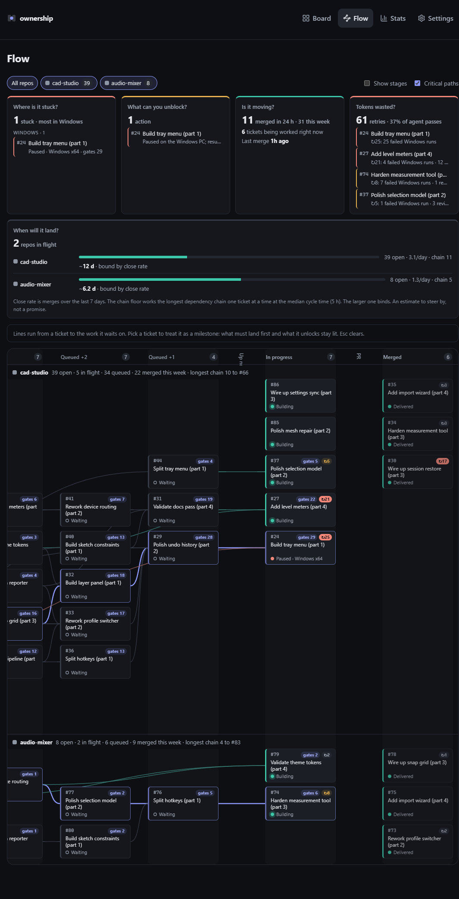
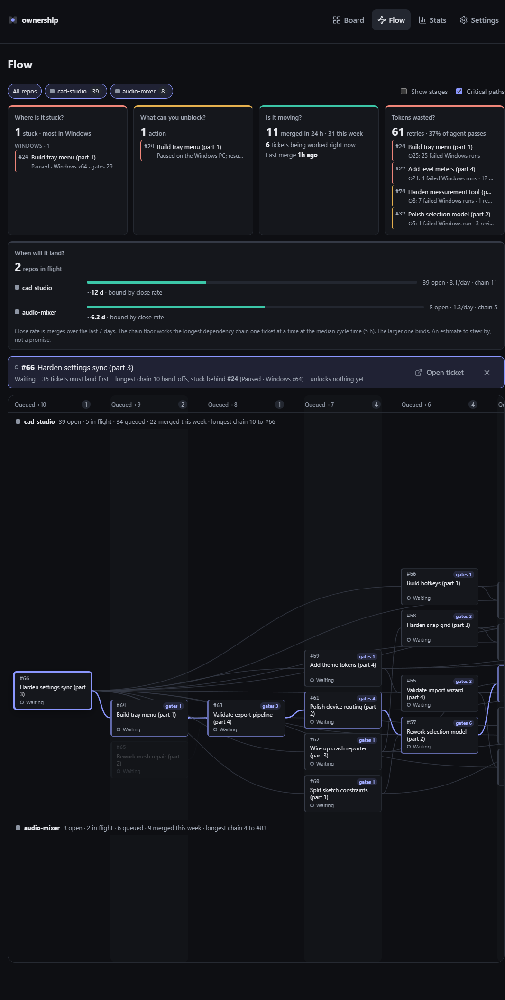

# Flow view (`#/flow`)

A read-only sandbox for the product owner, next to the board. The board answers
"what is each ticket doing?". The flow view answers what an owner asks of the
whole system, without caring how agents do the work:

1. **Where is the pipeline stuck?**
2. **What blockers can I help remove?**
3. **Is progress being made?**
4. **Are tokens being wasted?**
5. **When will each project land**, given its dependencies and close rate?

The board view is unchanged apart from one more icon link in its header.



## Layout: one canvas, every repo, flowing right

All repos with open work share one canvas, one **swimlane** each. Repo chips
filter lanes (click toggles, double-click shows one repo alone); the choice is
remembered per browser. Inside a lane, tickets drift left to right as they near
merged:

```
 Queued +3 │ Queued +2 │ Queued +1 │ Up next │ In progress │ PR │ Merged
```

- **Simple by default.** Design, build, Windows verification and review are
  one **In progress** column: the owner cares that work moves, not how. "Show
  stages" splits it into Design / Build / Windows / Review (and Up next into
  Shaping / Ready) using the same work-model signal as the card stepper.
- **The owner's order is kept.** Within a column, tickets sit in the order
  `GET /board` returns, which is the order the owner set on the board.
- **Queue columns** sit left of Up next. A ticket still waiting on unmerged
  dependencies goes `n` columns out, `n` being the hand-offs before it can
  start, so every dependency line runs rightwards from a ticket to the work it
  waits on and a long chain reads as one thread. Queue columns order tickets by
  the height of what they wait on (ties in board order) to keep threads
  straight.
- Columns empty in every lane collapse to a thin strip. The canvas scrolls
  sideways inside the page and opens at the right-hand end, where work is
  moving; the page never overflows (checked at 1080px portrait and 375px).
- Merged shows each lane's last three merges; the lane header counts the week.

Dependencies come from `waiting_on` on `GET /board`, which lists only unmerged
dependencies, so every line is live blocking work. No new endpoint is needed;
the forecast also reads the median cycle time from the existing `GET /stats`.

## Reading a node

Id, title, a status word from the board card's own activity label (Building,
Paused · Windows x64, Waiting, Needs you…) and up to two badges:

- **gates N**: tickets that transitively wait on this one.
- **↻ N**: retries (failed Windows runs + review fixes + PR repairs), amber
  from 5, red from 15. The tooltip breaks them down.

Colour says who holds the ball: green while an agent works, amber when the
owner is needed, red when blocked or paused, orange on the Windows PC.

## The cards above the canvas

| Card | Answers with |
| --- | --- |
| Where is it stuck? | Started tickets nobody is moving (blocked, paused, idle, queued for Windows), grouped by column, worst column first, each with what it gates. |
| What can you unblock? | Owner questions and approvals first, then blocks and paused Windows runs, then the single biggest gate. |
| Is it moving? | Merged in 24 h and this week, tickets being worked now, time since the last merge, started tickets with nobody on them. |
| Tokens wasted? | Retries across open work and their share of all agent passes, plus the worst loops. |
| When will it land? | Per repo: open vs merged this week, close rate, chain length and an estimate. |

### Forecast

Two floors on when a repo's open work could all merge:

- **Close rate**: open tickets ÷ merges per day over the last 7 days.
- **Chain**: the longest dependency chain worked strictly one after another at
  the board's median cycle time.

The larger binds and is named ("bound by close rate" or "bound by the
dependency chain"). It is an estimate to steer by, not a promise; with no
merges in the week there is no estimate.

## Critical path and milestones

Each lane's longest chain to its deepest queued ticket is drawn as a
highlighted thread. Clicking a node makes it the milestone: what must land
first and what it unlocks stay lit, the rest dims, and a bar states the chain
length and the ticket it is stuck behind. Esc or a second click clears it;
"Open ticket" opens it on the board.



## Implementation

- `web/src/lib/flow.ts`: pure analysis (queue depth, gates, critical path,
  retries, insights, forecast) and the layered layout. ~90 tickets with chains
  10+ deep lay out in a few milliseconds, so no layout library is added.
- `web/src/components/flow/`: page, filters, cards, focus bar and canvas
  (absolutely positioned nodes over one SVG of soft Bézier edges).
- Live: the page refetches on the board's event stream, like the board.

## Not done yet

- "Working in your order" check: flag a ticket started ahead of one the owner
  ranked higher. Board positions are per lane, so this needs the original rank
  kept when a ticket leaves todo.
- Real token spend: the board has retry counts, not tokens or cost per ticket.
